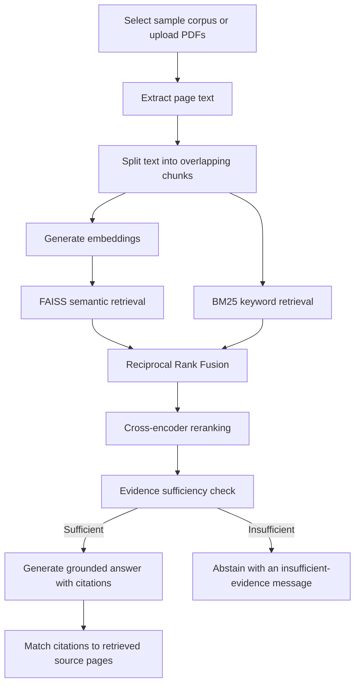

# 🔬 Evidence-Based RAG Research Assistant

An interactive Retrieval-Augmented Generation (RAG) application for asking questions about research papers and PDF reports. It combines dense semantic search, BM25 keyword retrieval, Reciprocal Rank Fusion (RRF), and cross-encoder reranking to retrieve relevant passages before generating an evidence-grounded answer with source-page citations.

<p align="center">
  <a href="https://research-evidence-analyst-dtgmee6svlkqpbg6ctazqk.streamlit.app/"><strong>🚀 Try the Live App</strong></a>
  &nbsp; | &nbsp;
  <a href="https://github.com/Ayesha-Ansa/research-evidence-analyst"><strong>📂 View Source Code</strong></a>
</p>

## Overview

Research papers and technical reports can be long and difficult to search manually. This project provides a question-answering interface that retrieves passages from a selected document corpus, checks whether the retrieved evidence appears sufficient, and generates an answer grounded in that evidence. When the evidence is insufficient, the app is designed to abstain rather than confidently invent an answer.

Users can search either the included sample corpus or upload their own text-based PDF documents for the current app session.

## Features

- **Two corpus options:** search the pre-indexed sample corpus or upload PDFs to create a temporary searchable corpus.
- **PDF processing:** extract text page by page, split it into overlapping chunks, and preserve source filenames and page numbers.
- **Dense semantic retrieval:** create embeddings for uploaded passages and search them with FAISS.
- **Keyword retrieval:** use BM25 to retrieve passages based on lexical overlap.
- **Hybrid ranking:** combine dense and BM25 rankings with Reciprocal Rank Fusion (RRF).
- **Cross-encoder reranking:** reorder retrieved candidates to prioritize passages most relevant to the question.
- **Evidence sufficiency check:** use an LLM-based check to decide whether retrieved passages are sufficient to answer.
- **Evidence-grounded synthesis:** generate a structured response from the retrieved passages and request source-page citations.
- **Citation matching:** check whether cited source/page pairs appear in the retrieved evidence.
- **Interactive Streamlit interface:** view the answer, citation table, active corpus information, and expandable retrieved passages with scores.
- **Dual API-key mode:** use a hosted OpenAI key by default when configured in Streamlit Secrets, or let visitors choose their own key.

## How It Works



### Retrieval pipeline

1. Extract and chunk the selected corpus while retaining source and page metadata.
2. Retrieve candidates through FAISS dense search and BM25 keyword search.
3. Combine candidate rankings with Reciprocal Rank Fusion.
4. Rerank the top candidates with a cross-encoder.
5. Ask the sufficiency evaluator whether the retrieved excerpts can answer the question.
6. If sufficient, generate a response grounded in the excerpts; otherwise, return an abstention message.
7. Compare citations in the response against the source-page pairs in the retrieved evidence.

## Technology Stack

- **Python** — application and retrieval pipeline
- **Streamlit** — interactive web interface and deployment
- **OpenAI API** — text embeddings, evidence sufficiency assessment, and answer generation
- **FAISS** — vector similarity search
- **BM25 (`rank-bm25`)** — keyword retrieval
- **Sentence Transformers / CrossEncoder** — reranking retrieved passages
- **pypdf** — PDF text extraction
- **NumPy and PyYAML** — vector operations and configuration

## Try the Live Demo

1. Open the [live Streamlit app](https://research-evidence-analyst-dtgmee6svlkqpbg6ctazqk.streamlit.app/).
2. Choose **Hosted demo key** if it is available, or select **Use my own API key**.
3. Choose the existing sample corpus, or upload one or more text-based PDF files in the sidebar.
4. If you uploaded files, click **Process Uploaded PDFs** and wait for processing to finish.
5. Select **Search uploaded PDFs** when you want the uploaded files to be the active corpus.
6. Enter a research question and click **Synthesize Answer**.
7. Review the generated synthesis, citation-matching table, and retrieved evidence passages.

### Upload limits in the public demo

To keep processing time and API usage bounded, the app currently allows up to:

- **3 PDFs** per upload selection
- **10 MB** per PDF
- **100 pages** per PDF
- **500 extracted chunks** across the upload selection

Uploaded-document indexes are held in the current Streamlit session and are not added to the permanent sample corpus. You may need to process the PDFs again in a new session.

## Configuration

Model names and retrieval settings are defined in [`config.yaml`](config.yaml). The current configuration uses:

- Embeddings: `text-embedding-3-small`
- Generation: `gpt-4.1-mini`
- Reranker: `cross-encoder/ms-marco-MiniLM-L-6-v2`

The application also uses fixed public-demo upload limits defined in `app.py`.

## Run Locally

### 1. Clone the repository

```bash
git clone https://github.com/Ayesha-Ansa/research-evidence-analyst.git
cd research-evidence-analyst
```

### 2. Install dependencies

```bash
pip install -r requirements.txt
```

### 3. Configure the OpenAI API key

For local development, create a `.streamlit` folder in the project directory and add a file named `secrets.toml`:

```toml
OPENAI_API_KEY = "your-openai-api-key"
```

Alternatively, set the `OPENAI_API_KEY` environment variable. **Never commit a real API key to GitHub.**

### 4. Run the app

```bash
streamlit run app.py
```

The app should open in your browser, usually at `http://localhost:8501`.

### Required project files

Keep the following files in the repository root:

- `app.py` — Streamlit interface and RAG pipeline
- `requirements.txt` — Python dependencies
- `config.yaml` — model and retrieval configuration
- `chunks.json` — preprocessed sample-corpus chunks
- `evidence.index` — FAISS index for the sample corpus

## API Key and Cost Notes

The public demo selects the hosted OpenAI API key by default when `OPENAI_API_KEY` is configured in Streamlit Secrets. Visitors can switch to their own OpenAI API key in the sidebar.

When the hosted key is used, API usage is charged to the account associated with that key. Public usage can consume API credits, so the hosted key should be monitored and usage should be controlled. ChatGPT subscriptions and OpenAI API billing are separate.

For deployment, add the key in the app's Streamlit Community Cloud **Settings → Secrets** using:

```toml
OPENAI_API_KEY = "your-openai-api-key"
```

Do not put the key in `app.py`, `config.yaml`, or any committed file.

## Evaluation and Functional Checks

The app has been manually smoke-tested with uploaded PDFs for two important behaviors:

- **Answerable question:** the app retrieved passages, generated a synthesis, and matched the extracted source-page citations against the retrieved evidence. One test displayed **3/3 citations matched**.
- **Insufficient-evidence question:** a question asking for September 2026 monthly revenue from a report covering an earlier analysis window resulted in an insufficient-evidence message instead of an invented revenue figure.

These are functional checks, not a comprehensive benchmark. Citation matching confirms that a cited filename/page is present in retrieved evidence; it does **not** independently prove that the cited passage entails the claim. Retrieval quality and LLM-based sufficiency decisions can still fail and should be evaluated on a broader set of questions and documents.

## Limitations and Responsible Use

- The PDF parser extracts embedded text; scanned image-only PDFs may require OCR and may not work as expected.
- LLM-based evidence sufficiency checks are imperfect. Review the retrieved passages and citations for important decisions.
- Citation matching validates source-page presence, not claim-level factual support.
- Uploaded PDF text is sent to the configured OpenAI API for embeddings and model requests. Do not upload confidential or sensitive documents unless you are authorized to share them with that service.
- The hosted demo key is a shared resource. API availability depends on the owner's quota and account settings.
- Uploaded-document indexes are session-scoped; this app is a portfolio demo, not a persistent document-management system.

## Repository Structure

```text
research-evidence-analyst/
├── app.py
├── config.yaml
├── chunks.json
├── evidence.index
├── requirements.txt
├── LICENSE
└── README.md
```

## License

This project is licensed under the MIT License. See [`LICENSE`](LICENSE) for details.

---

**Project:** Evidence-Based RAG Research Assistant  
**Live Demo:** https://research-evidence-analyst-dtgmee6svlkqpbg6ctazqk.streamlit.app/  
**Repository:** https://github.com/Ayesha-Ansa/research-evidence-analyst

