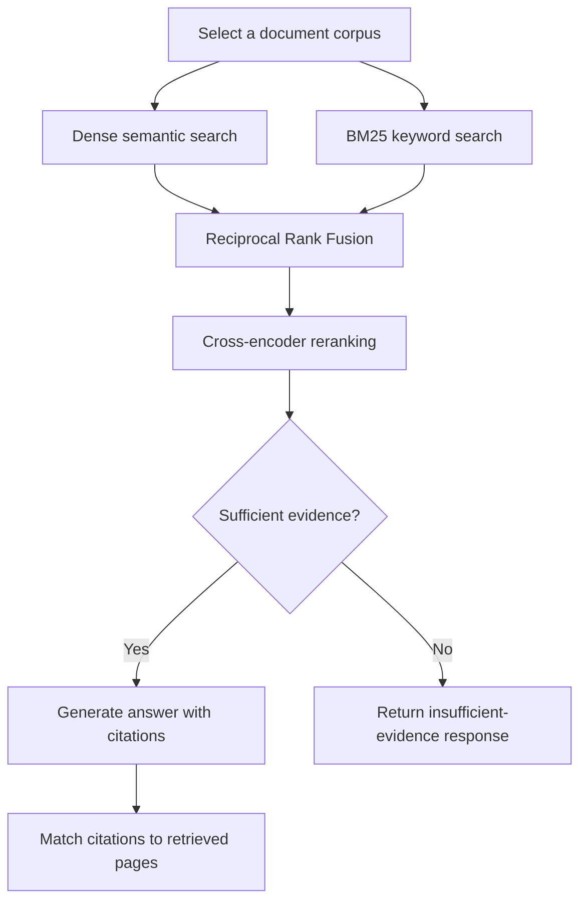

# 🔬 Evidence-Based RAG Research Assistant

An interactive Retrieval-Augmented Generation (RAG) application for exploring research papers and PDF reports.

The system combines **dense semantic search, BM25 keyword retrieval, Reciprocal Rank Fusion (RRF), and cross-encoder reranking** before checking evidence sufficiency and generating an answer with source-page citations.

**[🚀 Try the Live App](https://research-evidence-analyst-dtgmee6svlkqpbg6ctazqk.streamlit.app/)**

## 📌 Overview

Research papers can be difficult to search and compare manually. This project retrieves relevant passages from a selected document corpus and uses them to generate a research synthesis.

When the evidence appears insufficient, the application is designed to abstain. Users can inspect the retrieved passages, model scores and citation matches rather than relying on the generated answer alone.

This is a **portfolio prototype requiring human review**, not a guarantee of factual correctness.

## 📚 Included Sample Corpus

The application includes a prebuilt corpus containing **411 chunks** from three papers:

- `Analysis of PCA Algorithms in Distributed.pdf`
- `FINDING STRUCTURE WITH RANDOMNESS.pdf`
- `Sparse Principal Component Analysis.pdf`

The sample corpus is represented by `chunks.json` and `evidence.index`. The original PDFs are not provided as downloadable files in the app.

Users can also upload text-based PDFs to create a separate, temporary corpus for their current session.

## ✨ Features

- **Sample or uploaded corpus:** search the included papers or process your own PDFs.
- **Page-level extraction:** preserve filenames and PDF page numbers.
- **Semantic retrieval:** search OpenAI embeddings using FAISS.
- **Keyword retrieval:** identify lexical matches using BM25.
- **Rank fusion:** combine semantic and keyword rankings using RRF.
- **Cross-encoder reranking:** score candidate passages against the question.
- **Evidence sufficiency assessment:** check whether retrieved passages support an answer.
- **Source-page citations:** request references to the supplied evidence.
- **Citation matching:** check whether cited filename–page pairs appear in retrieved passages.
- **Result context:** display the question and corpus associated with an answer.
- **Session handling:** clear previous results when submitting another question or changing the active corpus.
- **Distinct upload filenames:** reject duplicate filenames to avoid ambiguous citations.
- **API-key options:** use a hosted key when configured or enter a personal key.

## 🔄 How It Works



The application retrieves up to ten candidates from each search method, combines their rankings, reranks up to twenty candidates and returns up to five evidence passages.

The sufficiency check and answer generation use pretrained language models. This project does not train an LLM.

## 🧠 Models and Configuration

| Component | Configuration |
|---|---|
| Embeddings | `text-embedding-3-small` |
| Generation and sufficiency assessment | `gpt-4.1-mini` |
| Reranker | `cross-encoder/ms-marco-MiniLM-L-6-v2` |
| Vector search | FAISS |
| Keyword search | BM25 |
| Dense candidates | 10 |
| Keyword candidates | 10 |
| RRF constant | 60 |
| Final evidence passages | Up to 5 |

The sample corpus was constructed using **900-character chunks with 150-character overlap**.

The deployed app uses **1,200-character chunks with 180-character overlap** for newly uploaded PDFs. These settings do not modify the existing sample index.

## ▶️ Try the App

1. Open the live app.
2. Choose the hosted demo key, if available, or enter your own OpenAI API key.
3. Use the sample corpus directly, or upload PDFs and click **Process Uploaded PDFs**.
4. Enable **Search uploaded PDFs** when you want to query the uploaded corpus.
5. Enter a question and click **Synthesize Answer**.
6. Review the synthesis, citation table and full evidence passages.

### Upload Limits

| Limit | Maximum |
|---|---:|
| PDFs per selection | 3 |
| File size per PDF | 10 MB |
| Pages per PDF | 100 |
| Extracted chunks across uploads | 500 |

Use distinct filenames for different PDFs.

Uploaded indexes remain in the current session and are not added to the permanent sample corpus.

## 📓 Development Notebook

`research_evidence_analyst.ipynb` contains the document-processing and evaluation workflow:

1. Configure models and prompts.
2. Extract PDF text.
3. Create overlapping chunks.
4. Generate embeddings and build a FAISS index.
5. Build BM25 retrieval.
6. Combine rankings and rerank passages.
7. Assess evidence and generate answers.
8. Match citations to source pages.
9. Inspect retrieval, abstention and claim-support outputs.
10. Save the document artifacts.

The notebook and deployed application are separate implementations. For example, the notebook uses regex-based BM25 tokenization, while the app uses lowercase whitespace splitting. Notebook evaluation results should therefore not be presented as a benchmark of the deployed app.

## 📊 Exploratory Evaluation

Evaluation uses a small set of development questions and manually selected source-page relevance labels. Some relevance labels were revised after inspecting retrieval results.

The results describe **exploratory checks**, not an independent benchmark or general accuracy estimate.

### Latest Notebook Retrieval Results

| Measure | Result |
|---|---:|
| Answerable questions evaluated | 5 |
| Mean unique-page precision within top-five passages | **73.7%** |
| Mean labelled-page recall within top-five passages | **100%** |
| Unanswerable questions tested | 2 |
| Correct abstentions in that run | **2/2** |

The precision and recall measures use **source-page labels**, not independently annotated passage-level relevance.

| Question topic | Unique-page precision | Labelled-page recall |
|---|---:|---:|
| Computational and communication challenges | 100.0% | 100.0% |
| Sparse PCA paper topic | 66.7% | 100.0% |
| Communication complexity | 75.0% | 100.0% |
| Computationally intensive methods | 60.0% | 100.0% |
| Sparse PCA paper contributions | 66.7% | 100.0% |

These figures reflect the revised development labels. They do not demonstrate that retrieval improved or that every relevant passage was found.

### Metric Definitions

- **Unique-page precision:** distinct retrieved source-page pairs labelled relevant, divided by all distinct source-page pairs represented in the top-five passages.
- **Labelled-page recall:** distinct labelled source-page pairs retrieved within the top-five passages, divided by all source-page pairs labelled relevant for that question.
- **Citation matching:** extracted filename–page references that appear in retrieved evidence.
- **Abstention check:** whether the system declines a question expected to be unanswerable from the selected corpus.

**Unique-page precision is not conventional passage Precision@5.** Multiple retrieved chunks can come from the same page, so the denominator can be smaller than five.

### Historical LLM-Judge Record

An earlier manually recorded evaluation reported **nine claims across two answers judged supported by an LLM evaluator**.

Those counts remain labelled historical in the notebook. They are not automatically recalculated from the latest generated answers and are not independent human verification. They should not be interpreted as a current faithfulness score.

## 🧪 Live Functional Checks

The following behaviours were observed in manual testing:

| Check | Observed behaviour |
|---|---|
| Sparse PCA question | Retrieved five passages and generated an answer with citations. |
| Citation matching for that answer | Three unique cited source-page pairs matched retrieved evidence. |
| Empty submission | Displayed a validation message and cleared the previous results. |
| Out-of-corpus revenue question | Returned an insufficient-evidence response. |
| Answer context | Displayed the submitted question and searched corpus. |

These are individual functional checks, not aggregate accuracy measurements.

### Answer-Quality Finding

The sparse PCA test also exposed an important limitation: an answer with matching citations still contained the incorrect generalization that standard PCA assumes all variables contribute equally. It also described a particular wavelet-based approach too broadly.

This illustrates why **citation matching does not establish factual correctness**. Users should inspect the passages and verify the scope of generated claims.

## 💡 Example Questions

Use the sample corpus for these exploratory questions:

- What computational and communication challenges arise in distributed PCA?
- How does the sparse PCA approach described in the supplied paper differ from standard PCA?
- What role does randomness play in the methods described in *FINDING STRUCTURE WITH RANDOMNESS*?
- Which methods does the distributed PCA paper identify as computationally intensive?

To check abstention:

> What exact monthly revenue did the Chicago Rideshare project generate in September 2026?

That information is absent from the sample research corpus, so the app should report insufficient evidence.

## 🛠️ Technology Stack

| Technology | Purpose |
|---|---|
| Python | Application and processing logic |
| Streamlit | Interactive interface |
| OpenAI API | Embeddings, sufficiency assessment and answer generation |
| FAISS | Vector similarity search |
| `rank-bm25` | Keyword retrieval |
| Sentence Transformers | Cross-encoder reranking |
| PyMuPDF | PDF extraction in the notebook |
| `pypdf` | Uploaded-PDF extraction in the app |
| NumPy | Vector operations |
| PyYAML | Configuration handling |

## 💻 Run Locally

### 1. Clone the Repository

```bash
git clone https://github.com/Ayesha-Ansa/research-evidence-analyst.git
cd research-evidence-analyst
```

### 2. Install App Dependencies

```bash
pip install -r requirements.txt
```

The notebook includes its own installation cell for its development dependencies.

### 3. Configure an API Key

Create `.streamlit/secrets.toml`:

```toml
OPENAI_API_KEY = "your-openai-api-key"
```

Alternatively, set the `OPENAI_API_KEY` environment variable. The app also supports entering a personal key through its interface.

**Never commit a real API key or secrets file.**

### 4. Start the App

```bash
streamlit run app.py
```

Keep these files together:

- `app.py`
- `config.yaml`
- `chunks.json`
- `evidence.index`
- `requirements.txt`

The notebook is not required to launch the website.

## 📦 Corpus Artifacts

`chunks.json` and `evidence.index` must represent the same chunk order.

If rebuilding the sample corpus, replace **both files together**. Matching vector and chunk counts alone does not establish that their ordering matches.

The notebook’s configuration supports its development workflow. Do not overwrite the deployed app configuration or dependency file without checking compatibility.

## 🔑 API Usage

The app uses the hosted key when configured, with an option for visitors to use their own key.

Embedding requests, sufficiency checks and answer generation consume API credits. Hosted availability depends on the owner’s quota and account settings.

For Streamlit deployment, configure `OPENAI_API_KEY` through **Settings → Secrets**.

## ⚠️ Limitations

- Scanned PDFs require OCR, which is not included.
- PDF extraction can lose table structure, equations and formatting.
- Retrieval may miss relevant passages.
- Evidence sufficiency judgments can be incorrect.
- Generated answers can overgeneralize or contain unsupported statements.
- Citation matching verifies source-page presence, not claim support.
- Development relevance labels are incomplete and were revised after inspection.
- Small evaluation samples do not establish general reliability.
- Notebook results do not directly benchmark the deployed implementation.
- Uploaded document text is sent to the configured API; use only documents you are authorized to share.
- Uploaded corpora are session-scoped rather than persistent.

## 🔮 Future Improvements

- Create an independent evaluation set with fixed relevance labels.
- Annotate relevance at passage level.
- Evaluate answer correctness separately from citation matching.
- Record false abstentions as well as correct refusals.
- Align notebook and app processing for direct comparisons.
- Improve handling of tables, equations and scanned PDFs.
- Add more challenging and partially answerable questions.

## 📁 Project Files

| File | Purpose |
|---|---|
| `research_evidence_analyst.ipynb` | Corpus construction, experiments and evaluation |
| `app.py` | Deployed Streamlit application |
| `config.yaml` | App model, retrieval, chunking and prompt settings |
| `chunks.json` | Sample passages with source-page metadata |
| `evidence.index` | Corresponding FAISS vector index |
| `requirements.txt` | App dependencies |
| `README.md` | Documentation and evaluation scope |
| `LICENSE` | Project code licence |

## 👩‍💻 Author

**Ayesha Ansari**

Data Science & AI | NLP | Generative AI

## License

Project code is licensed under the MIT License. See [`LICENSE`](LICENSE). Source research papers remain subject to their respective licences.
