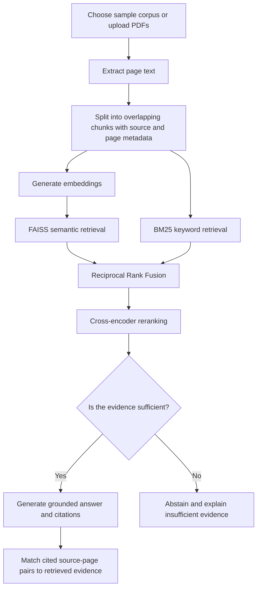

# 🔬 Evidence-Based RAG Research Assistant

An interactive Retrieval-Augmented Generation (RAG) application for asking questions about research papers and PDF reports. It combines dense semantic search, BM25 keyword retrieval, Reciprocal Rank Fusion (RRF), and cross-encoder reranking to retrieve relevant passages before generating an evidence-grounded answer with source-page citations.

<p align="center">
  <a href="https://research-evidence-analyst-dtgmee6svlkqpbg6ctazqk.streamlit.app/"><strong>🚀 Try the Live App</strong></a>
</p>

## Overview

Research papers and technical reports can be long and difficult to search manually. This project provides a question-answering interface that retrieves passages from a selected document corpus, checks whether the retrieved evidence appears sufficient, and generates an answer grounded in that evidence. When the evidence is insufficient, the app is designed to abstain rather than confidently invent an answer.

Users can search either the included sample corpus or upload their own text-based PDF documents for the current app session.

## Included Sample Corpus

The app includes a preprocessed, searchable sample corpus built from these three research papers. Recruiters can try the benchmark questions below without uploading a document first. The sample papers are represented in the prebuilt `chunks.json` and `evidence.index` files; they are not presented as downloadable PDFs in the app interface.

- `Analysis of PCA Algorithms in Distributed.pdf`
- `FINDING STRUCTURE WITH RANDOMNESS.pdf`
- `Sparse Principal Component Analysis.pdf`

You can also upload your own text-based PDFs. Uploaded documents are processed into a separate, session-scoped corpus and do not replace or permanently alter the sample corpus.

## Features

- **Two corpus options:** search the pre-indexed sample corpus or upload PDFs to create a temporary searchable corpus.
- **PDF processing:** extract text page by page, split it into overlapping chunks, and preserve source filenames and page numbers.
- **Dense semantic retrieval:** create embeddings for uploaded passages and search them with FAISS.
- **Keyword retrieval:** use BM25 to retrieve passages based on lexical overlap.
- **Hybrid ranking:** combine dense and BM25 rankings with Reciprocal Rank Fusion (RRF).
- **Cross-encoder reranking:** reorder retrieved candidates to prioritize passages most relevant to the question.
- **Evidence sufficiency check:** use an LLM-based check to decide whether retrieved passages are sufficient to answer.
- **Evidence-grounded synthesis:** generate a structured response from the retrieved passages and request source-page citations.
- **Citation matching:** check whether cited source/page pairs appear in the retrieved evidence.
- **Interactive Streamlit interface:** view the answer, citation table, active corpus information, and expandable retrieved passages with scores.
- **Dual API-key mode:** use a hosted OpenAI key by default when configured in Streamlit Secrets, or let visitors choose their own key.

## How It Works



### Retrieval pipeline

1. Extract and chunk the selected corpus while retaining source and page metadata.
2. Retrieve candidates through FAISS dense search and BM25 keyword search.
3. Combine candidate rankings with Reciprocal Rank Fusion.
4. Rerank the top candidates with a cross-encoder.
5. Ask the sufficiency evaluator whether the retrieved excerpts can answer the question.
6. If sufficient, generate a response grounded in the excerpts; otherwise, return an abstention message.
7. Compare citations in the response against the source-page pairs in the retrieved evidence.

## Why This Project Matters for Data Analyst / Data Scientist Roles

**For Data Analyst roles**, this project demonstrates the ability to turn long, unstructured documents into usable evidence; validate outputs rather than relying on a fluent response alone; communicate findings with traceable sources; and explain limitations clearly to a stakeholder.

**For Data Scientist and applied AI roles**, it demonstrates an end-to-end retrieval pipeline: embedding-based search, lexical retrieval, rank fusion, cross-encoder reranking, evidence sufficiency assessment, citation matching, and evaluation of failure cases. It also highlights an important model-behavior decision: abstaining when the available evidence does not support an answer.

**For both paths**, the project combines Python, data processing, API integration, reproducible setup, a deployed interactive app, and an evaluation mindset. It is a portfolio prototype—not a claim that the system is production-ready or fully reliable.

## Technology Stack

- **Python** — application and retrieval pipeline
- **Streamlit** — interactive web interface and deployment
- **OpenAI API** — text embeddings, evidence sufficiency assessment, and answer generation
- **FAISS** — vector similarity search
- **BM25 (`rank-bm25`)** — keyword retrieval
- **Sentence Transformers / CrossEncoder** — reranking retrieved passages
- **pypdf** — PDF text extraction
- **NumPy and PyYAML** — vector operations and configuration

## Try the Live Demo

1. Open the [live Streamlit app](https://research-evidence-analyst-dtgmee6svlkqpbg6ctazqk.streamlit.app/).
2. Choose **Hosted demo key** if it is available, or select **Use my own API key**.
3. To try the included sample corpus, enter a question directly; the pre-indexed sample corpus is used by default in a fresh session.
4. To test custom documents, upload one or more text-based PDFs in the sidebar and click **Process Uploaded PDFs**.
5. Make sure **Search uploaded PDFs** is enabled when you want your uploaded files to be the active corpus.
6. Enter a research question and click **Synthesize Answer**.
7. Review the generated synthesis, citation-matching table, and retrieved evidence passages.

### Upload limits in the public demo

To keep processing time and API usage bounded, the app currently allows up to:

- **3 PDFs** per upload selection
- **10 MB** per PDF
- **100 pages** per PDF
- **500 extracted chunks** across the upload selection

Uploaded-document indexes are held in the current Streamlit session and are not added to the permanent sample corpus. You may need to process the PDFs again in a new session.

## Evaluation

Evaluation is an ongoing part of this project. The results below come from a **small preliminary evaluation and manual functional checks**; they should not be interpreted as a comprehensive or statistically robust benchmark.

### Preliminary results

| Check | Observed result | How to interpret it |
|---|---:|---|
| Retrieval Precision@5 | **32.3%** | Average proportion of the top-five retrieved passages judged relevant in an earlier small evaluation. |
| Retrieval Recall@5 | **100%** | All passages marked relevant for the evaluated answerable questions were retrieved within the top five in that small evaluation. |
| Insufficient-evidence tests | **2/2 passed** | Both tested unanswerable questions triggered an abstention rather than a fabricated answer. |
| Citation matching in one uploaded-PDF answer | **3/3 matched** | Three unique cited source-page pairs were present in the retrieved evidence for this example. This is not an overall citation-quality score. |
| LLM-judge review of generated claims | **9/9 judged supported** | A model-based evaluator judged nine claims across two answers as supported; this is not an independent human verification. |

These measurements come from different small test runs and should not be combined into a single score. In particular, citation matching verifies that a source/page pair appears in retrieved evidence; it does **not** establish that the cited passage actually entails the associated claim.

### Starter benchmark questions

Use the **pre-indexed sample corpus** for Q1, Q2, Q3, and Q5; no separate PDF download is required. Q4 is an out-of-corpus question designed to check whether the app abstains when the sample papers do not contain the requested information. These are proposed starter tests, not claims that every question has already been fully benchmarked. Run them and review the retrieved passages and citations before reporting per-question results.

| Test | Question | Expected answer or behavior | Evaluation focus |
|---|---|---|---|
| Q1 — Distributed PCA | “What approaches to PCA in distributed environments are discussed in *Analysis of PCA Algorithms in Distributed*?” | Summarize the approaches and trade-offs actually described in the paper, and cite the supporting source pages. Do not add claims that are not in the retrieved passages. | Retrieval relevance, grounded synthesis, citation matching |
| Q2 — Sparse PCA | “How does sparse PCA differ from standard PCA, and what motivation for sparsity does the paper provide?” | Explain the distinction using evidence from *Sparse Principal Component Analysis.pdf* and cite the relevant pages. | Precision@k, Recall@k, source traceability |
| Q3 — Randomized methods | “What role does randomness play in the methods described in *FINDING STRUCTURE WITH RANDOMNESS*?” | Summarize the paper’s treatment of randomized methods using retrieved evidence and source-page citations. | Retrieval relevance, answer grounding, citation matching |
| Q4 — Missing information | “What exact monthly revenue did the Chicago Rideshare project generate in September 2026?” | Since the Chicago Rideshare report is not part of the permanent sample corpus, the app should state that the available papers do not establish this figure rather than inventing a number. | Abstention correctness, out-of-corpus handling |
| Q5 — Citation audit | Ask a specific question whose answer is clearly stated on a known page of one of the three sample papers. | Check that the answer names the correct PDF and page, that the cited source-page pair is present among the retrieved passages, and manually review whether the passage supports the claim. | Citation match rate, source traceability, manual claim-support review |

**How to run the tests:** open the [live app](https://research-evidence-analyst-dtgmee6svlkqpbg6ctazqk.streamlit.app/) in a fresh session and ask Q1–Q3 and Q5 directly; the pre-indexed sample corpus is selected by default. For Q4, use the same corpus and verify that the app abstains. To test the upload feature separately, upload a text-based PDF, click **Process Uploaded PDFs**, and make sure **Search uploaded PDFs** is enabled before asking a question about that document.

For a stronger future benchmark, record each question, expected key points, relevant pages, retrieved passage IDs, and pass/fail judgments in CSV or JSON. Add relevance labels for the candidate passages before reporting retrieval metrics. Rerun the same cases whenever prompts or retrieval settings change, and include examples of failures as well as successes.

### Metric definitions

- **Precision@5:** relevant passages among the top five retrieved passages, divided by five.
- **Recall@5:** relevant passages retrieved in the top five, divided by all passages marked relevant for that question.
- **Citation match rate:** cited source-page references that match retrieved evidence, divided by extracted citation references. This is a source-page check, not claim-level entailment verification.
- **Abstention accuracy on test cases:** unanswerable test questions correctly refused, divided by all unanswerable test questions evaluated.

## Deployment and Reproducibility

The public demo is hosted on **Streamlit Community Cloud**. The same application can also be run locally with Python and the files in this repository; local execution does not require Streamlit Community Cloud. Follow the setup below to reproduce the app in your own environment.

## Run Locally

### 1. Clone the repository

```bash
git clone https://github.com/Ayesha-Ansa/research-evidence-analyst.git
cd research-evidence-analyst
```

### 2. Install dependencies

```bash
pip install -r requirements.txt
```

### 3. Configure the OpenAI API key

For local development, create a `.streamlit` folder in the project directory and add a file named `secrets.toml`:

```toml
OPENAI_API_KEY = "your-openai-api-key"
```

Alternatively, set the `OPENAI_API_KEY` environment variable. **Never commit a real API key to GitHub.**

### 4. Run the app

```bash
streamlit run app.py
```

The app should open in your browser, usually at `http://localhost:8501`.

### Required project files

Keep the following files in the repository root:

- `app.py` — Streamlit interface and RAG pipeline
- `requirements.txt` — Python dependencies
- `config.yaml` — model and retrieval configuration
- `chunks.json` — preprocessed sample-corpus chunks
- `evidence.index` — FAISS index for the sample corpus

## API Key and Cost Notes

The public demo selects the hosted OpenAI API key by default when `OPENAI_API_KEY` is configured in Streamlit Secrets. Visitors can switch to their own OpenAI API key in the sidebar.

When the hosted key is used, API usage is charged to the account associated with that key. Public usage can consume API credits, so the hosted key should be monitored and usage should be controlled. ChatGPT subscriptions and OpenAI API billing are separate.

For deployment, add the key in the app's Streamlit Community Cloud **Settings → Secrets** using:

```toml
OPENAI_API_KEY = "your-openai-api-key"
```

Do not put the key in `app.py`, `config.yaml`, or any committed file.

## Limitations and Responsible Use

- The PDF parser extracts embedded text; scanned image-only PDFs may require OCR and may not work as expected.
- LLM-based evidence sufficiency checks are imperfect. Review the retrieved passages and citations for important decisions.
- Citation matching validates source-page presence, not claim-level factual support.
- Uploaded PDF text is sent to the configured OpenAI API for embeddings and model requests. Do not upload confidential or sensitive documents unless you are authorized to share them with that service.
- The hosted demo key is a shared resource. API availability depends on the owner's quota and account settings.
- Uploaded-document indexes are session-scoped; this app is a portfolio demo, not a persistent document-management system.

## Repository Structure

```text
research-evidence-analyst/
├── app.py
├── config.yaml
├── chunks.json
├── evidence.index
├── requirements.txt
├── LICENSE
└── README.md
```

## License

This project is licensed under the MIT License. See [`LICENSE`](LICENSE) for details.

